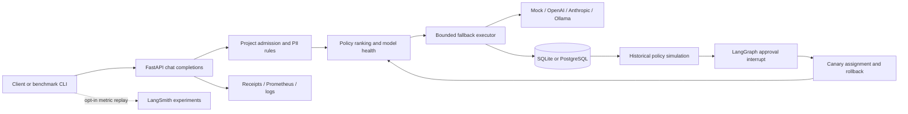

# InferenceIQ

InferenceIQ is a FastAPI inference gateway with explainable model routing and a
benchmark harness for testing routing decisions. It compares fixed-model requests
with cost, latency, quality, and balanced policies, records inference receipts,
and exercises fallback and persistent circuit breakers through the same endpoint.

The repository includes LangGraph policy approval, optional LangSmith evaluation,
a React operations dashboard, and reproducible mock-only reliability tests.
Live-provider cost savings and answer-quality retention have not been established.

## Architecture



The diagram describes non-streaming inference. SQLite supports local development;
PostgreSQL supports shared application state and LangGraph checkpoints.
See [architecture and request flows](docs/ARCHITECTURE.md) for component boundaries.

| Provider | Adapter | Configuration |
|---|---|---|
| Mock | Deterministic prompt echo | Default; no credentials or network calls |
| OpenAI | Async OpenAI SDK | API key, model ID, reviewed token prices |
| Anthropic | LangChain `ChatAnthropic` | API key, model ID, reviewed token prices |
| Ollama | LangChain `ChatOllama` | Enable adapter and configure reachable local server/model |

`model: "auto"` ranks eligible models by configured quality estimates, token
prices, latency estimates or observations, and health. The four policies change
these weights; they do not learn from prompts or benchmark scores. An explicit
`provider/model` request selects one candidate and cannot fall back to another.
Receipts explain selection, rejected candidates, observed usage, and fallback.

Retryable provider errors can advance to the next ranked candidate within
`max_attempts`. Non-retryable errors stop execution. Persistent health tracks
failures and the `closed -> open -> half_open -> closed/open` circuit lifecycle.

LangGraph validates and simulates a proposed policy, pauses for human approval
with a durable interrupt, then records canary or rejected status. Request-time
assignment and error/cost/latency rollback guardrails live outside the graph.
Historical simulation uses estimates; it does not execute counterfactual answers
or validate their quality, and approval does not automatically fully promote a policy.

## Local startup

Use Python 3.11+ (CI uses 3.13). From the repository root in PowerShell:

```powershell
python -m venv .venv
.venv\Scripts\python.exe -m pip install -e ".[dev]"
# On first setup only; preserve an existing local .env.
if (!(Test-Path .env)) { Copy-Item .env.example .env }
.venv\Scripts\python.exe -m alembic upgrade head
.venv\Scripts\python.exe -m uvicorn app.main:app --reload
```

For this demo, keep `PROVIDER=mock`, leave external provider keys unset, disable
Ollama, and keep `INFERENCEIQ_LANGSMITH_ENABLED=false` and SDK tracing disabled.
Review local configuration without printing secrets. Local defaults disable
project authentication; they are development settings, not deployment settings.

Open [API docs](http://127.0.0.1:8000/docs),
[readiness](http://127.0.0.1:8000/ready), or
[metrics](http://127.0.0.1:8000/metrics). The dashboard requires a frontend build:

```powershell
npm --prefix dashboard ci
npm --prefix dashboard run build
# Restart the API after building, then open http://127.0.0.1:8000/dashboard/
```

Node 22 is used by CI and Docker. Alternatively, run
`npm --prefix dashboard run dev` and open `http://localhost:5173/dashboard/`;
the development UI defaults to the API at port 8000. Admin operations require the
configured admin token; enter it locally rather than placing it in commands or reports.

[Docker deployment](docs/DEPLOYMENT.md) covers the multi-stage image, PostgreSQL,
one-shot migrations, required secrets, readiness, and operational limitations.

## Demo: route, inject a failure, inspect fallback

1. With the local mock API running, request automatic quality routing:

   ```powershell
   $response = Invoke-RestMethod -Method Post -Uri http://127.0.0.1:8000/v1/chat/completions -ContentType "application/json" -Body '{"model":"auto","messages":[{"role":"user","content":"Explain caching"}],"temperature":0,"max_tokens":32,"inferenceiq":{"policy":"quality","max_attempts":2}}'
   $response.inference_receipt | Select-Object selected_model, policy, reason
   ```

   A fresh mock catalog selects `mock/quality`. Change the policy to `cost` to
   inspect a different ranking. These are catalog decisions, not measured answer quality.

2. Run the controlled fault scenario below. It uses a separate in-process FastAPI
   application through HTTPX ASGI transport, not the running development server.
   Each arm starts with independent database/health state. The scenario injects
   429, 503, timeout, and non-retryable authentication errors and advances a
   virtual cooldown clock. It submits 100 requests per arm, 500 total.

   ```powershell
   New-Item -ItemType Directory -Force build | Out-Null
   .venv\Scripts\python.exe -m app.evaluation.cli --dataset evaluations/smoke.json --mock-smoke --fault-scenario evaluations/failover.json --fixed-models mock/fast --repetitions 50 --concurrency 1 --max-attempts 2 --temperature 0 --max-tokens 32 --output build/failover-walkthrough.json
   $report = Get-Content build/failover-walkthrough.json -Raw | ConvertFrom-Json
   $example = $report.results | Where-Object { $_.arm -eq "auto:latency" -and $_.gateway_attempts -gt 1 } | Select-Object -First 1
   $example | Select-Object fault_request_index, selected_model, success, gateway_attempts
   $example.attempt_details | Format-Table model, status_code, success, retryable
   $report.arms | Select-Object arm, success_rate, p50_latency_ms, p95_latency_ms, reliability
   ```

   The verified trial's request 11 in `auto:latency` attempted `mock/fast` (429),
   then completed on `mock/balanced` (200). Non-retryable faults still stop retries.
   Existing output files are refused; choose a fresh filename for another trial.

3. Compare answer checks and simulated pricing on the versioned 60-case dataset:

   ```powershell
   .venv\Scripts\python.exe -m app.evaluation.cli --dataset evaluations/quality.v1.json --mock-smoke --fixed-models mock/fast --repetitions 1 --concurrency 1 --temperature 0 --max-tokens 64 --output build/quality-walkthrough.json
   ```

   No server, paid model, semantic judge, or upload is used by either benchmark.
   See [benchmark methodology](docs/BENCHMARKS.md) for scoring, denominators,
   scenario configuration, missing measurements, and live-run dry-run/budget guards.

## Verified mock results

These values were read from preserved local `build/failover-demo.json` and
`build/quality-smoke.json`, generated with the configurations above. Reports are
ignored local artifacts; reproduce them with fresh filenames. Latencies below
are measured local ASGI client wall time, rounded to two decimals, with no TCP
or real model serving. Outcomes, word-count tokens, and mock prices are simulated.
They are examples from individual trials, not performance targets or live-provider evidence.

Fault scenario: 100 requests per arm; recovery means success in 40 explicit
fault-free recovery-window requests. Mean attempts includes zero-attempt circuit
blocks. Fallback success counts requests with at least two provider attempts.

| Arm | HTTP success | Recovery-window success | Fallback success | Mean attempts | p50 / p95 ms |
|---|---:|---:|---:|---:|---:|
| Fixed `mock/fast` | 76/100 | 36/40 | N/A (0 requests) | 0.84 | 5.35 / 7.64 |
| Auto cost | 97/100 | 40/40 | 3/3 | 1.03 | 5.87 / 8.53 |
| Auto latency | 97/100 | 40/40 | 6/6 | 1.06 | 5.90 / 8.88 |
| Auto quality | 100/100 | 40/40 | 2/2 | 1.02 | 5.58 / 7.79 |
| Auto balanced | 99/100 | 40/40 | 1/1 | 1.01 | 5.93 / 8.07 |

Quality dataset: 60 requests per arm, all HTTP-successful. Mock echo answers pass
0/54 deterministic cases in every arm; six semantic cases remain unknown without
a judge. No quality-passing cost can be calculated (reported `null`).

| Arm | Simulated USD/request | p50 / p95 ms |
|---|---:|---:|
| Fixed `mock/fast` | 0.00000513 | 4.08 / 6.20 |
| Auto cost | 0.00000513 | 4.89 / 6.49 |
| Auto latency | 0.00000513 | 4.21 / 6.98 |
| Auto quality | 0.00026050 | 4.37 / 7.40 |
| Auto balanced | 0.00003453 | 4.45 / 5.96 |

Prices use `mock-price-v1`; dataset version is `general-quality-v1`. Different mock
prices do not establish production savings or quality retention. Failed-call and
fallback costs can be unknown; missing costs, usage, or scores are not zero.

## Evaluation, trade-offs, and limits

- Deterministic exact, numeric, JSON, and substring checks run locally. Optional
  semantic judging uses a shared reference/rubric and reports invalid or missing
  judgments as unknown. No live quality-validation results or calibrated judge
  agreement are available; the 60-case set is a development dataset.
- Optional LangSmith experiments replay locally computed scalar metrics and hashed
  case IDs with versioned configuration. `--publish-langsmith` is explicitly opt-in;
  uploads are disabled by default. Server metadata tracing is separately configured.
  SDK integration is tested with fakes; no live upload has been validated.
- Weighted ranking is explainable and inexpensive, but catalog quality is static,
  not measured task quality. Historical simulation reuses token counts and
  estimated latency; it cannot establish alternate-model performance.
- Durable health survives requests/restarts, but half-open probes have no exclusive
  cross-worker lease. A regression test demonstrates concurrent double probing.
  An atomic expiring database probe lease is the proposed fix; serial demos avoid
  the race. A low-ranked half-open model can also remain unprobed.
- Streaming is supported by adapters but bypasses bounded fallback and completed
  outcome accounting. Benchmarks cover non-streaming, not time-to-first-token.
- Explicit model selection bypasses automatic retention filtering. Catalog retention
  flags and PII pattern rules are configuration controls, not security guarantees.
  Development defaults require further deployment hardening.
- Price estimates are not invoices: hardware costs, failed-call usage, and hidden
  SDK retries are incomplete. Live runs need explicit approval and budget guards;
  the client guard cannot guarantee a provider invoice ceiling. No production
  cost savings, quality retention, or reliability improvements are claimed here.

## Validation and documentation

```powershell
.venv\Scripts\python.exe -m pytest
.venv\Scripts\python.exe -m ruff format --check app tests migrations
.venv\Scripts\python.exe -m ruff check app tests migrations
```

Tests cover routing, provider adapters, endpoint behavior, access/privacy controls,
LangGraph approval, rollback, persistent circuit transitions, deterministic fault
schedules, quality evaluators, unknown costs, and experiment opt-in behavior.
Frontend validation uses `npm --prefix dashboard run build`; no separate frontend
test script is defined. CI also checks migrations, compilation, dependency audit,
and container builds; configured CI checks are not proof of a successful local deployment.

- [Architecture](docs/ARCHITECTURE.md) and [API reference](docs/API_REFERENCE.md)
- [Benchmark commands and methodology](docs/BENCHMARKS.md)
- [Deployment and operations](docs/DEPLOYMENT.md)
- [Project guide](docs/PROJECT_DOCUMENTATION.md)
- [Contributing](CONTRIBUTING.md) and [vulnerability reporting](SECURITY.md)

Licensed under MIT.
