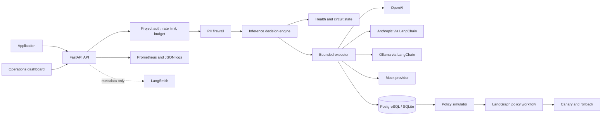
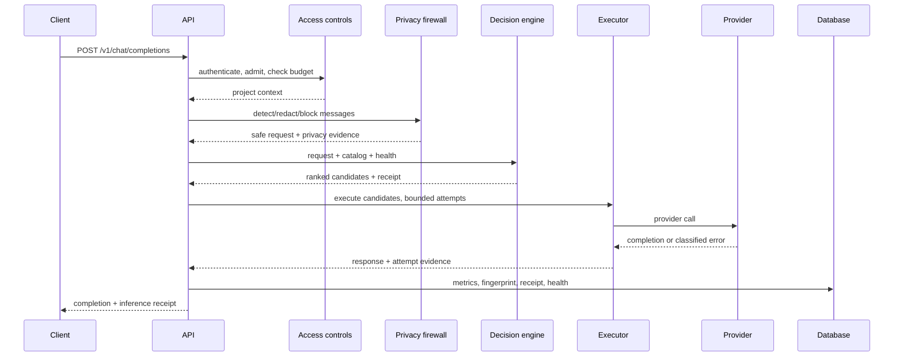
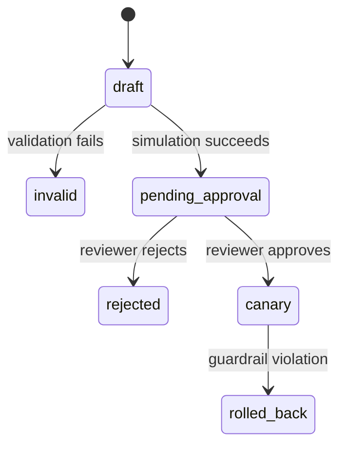

# Architecture

## System view

## Non-streaming request sequence

## Decision design

The engine applies hard constraints before weighted scoring. A model with an
open circuit, or without a requested zero-data-retention property, is removed
from automatic routing before scores are compared. Policy-specific weights then rank eligible models by
static catalog quality estimates, configured cost, and predicted or observed latency.
Degraded health lowers a score. Quality is not learned from prompt content or
benchmark answers; policy names describe weighting preferences, not guarantees.

Explicit model requests remain deterministic. If the requested model has an
open circuit, the API returns service unavailable instead of silently selecting
a different model. Explicit requests bypass automatic retention filtering and have
no cross-model fallback.

## Provider boundary

All adapters implement one async completion and streaming contract. Adapters own
SDK translation; the executor owns retry classification and bounded fallback.
Policy code consumes the shared contract rather than SDK-specific messages. The
attempt limit bounds gateway candidate calls, not hidden retries within an SDK.
Streaming uses a separate adapter path and does not share bounded fallback or
completed inference accounting.

## Persistence

Alembic-managed records cover inference outcomes, feedback, policy versions and
rollouts, projects and hashed API keys, rate admissions and monthly usage,
signed audit events, and provider health. Raw prompts and completions are not
stored. A SHA-256 request fingerprint supports deterministic canary assignment.

## Policy lifecycle

LangGraph is used because human review is a durable interrupt in a multi-step
state machine. Policy and checkpoint state survive API restarts. The router
reads the active canary and assigns eligible traffic from the request
fingerprint.

## Reliability and scaling

- Only retryable errors fall back, and `max_attempts` caps upstream work.
- Provider attempts update durable health even when fallback succeeds.
- Circuits transition `closed -> open -> half_open -> closed/open`.
- `/ready` verifies database connectivity; `/health` is process liveness.
- PostgreSQL serializes rate admission per project across API replicas.
- LangSmith failure never fails inference or feedback.

The API is otherwise stateless and can be replicated. PostgreSQL coordinates
projects, admission, usage, health, audits, and policy state. This does not make
half-open probing exclusive: concurrent requests can both enter a half-open
model, as demonstrated by a regression test. Serial fault benchmarks avoid the
race. An atomic expiring per-model probe lease with completion-token checks is
the proposed cross-worker fix; it has not been implemented. See the
[reliability methodology](BENCHMARKS.md#concurrent-half-open-safety-finding).
Production should also use PostgreSQL checkpoints plus TLS, backups, centralized logs, alerting,
and an identity-aware proxy for the admin surface.

## Evaluation boundary

`app/evaluation/cli.py` and `runner.py` compare explicit baselines and all four
automatic policies through the non-streaming FastAPI route. Mock mode uses ASGI
transport and independent in-memory application/checkpoint state per arm; fault
mode wraps the mock provider and advances a virtual health clock. Remote arms
share server state and need a controlled deployment.

Versioned datasets, deterministic checks, optional semantic judgments, and price
snapshots support local per-case JSON reports. Unknown quality, usage, and costs
remain unknown. Optional LangSmith experiments replay computed scalar metrics
and hashed identifiers, with publication disabled by default. No live-provider
quality, production savings, or successful live experiment upload has been
established by the mock tests. Historical simulation and canary guardrails do
not measure answer-quality retention.
